# Reportes de defectos

Exploración manual de problem_user y error_user (casos TC42, TC43 y TC44), comparando contra standard_user y los requerimientos RF05 a RF10.

- Ambiente: Windows 11, Google Chrome, https://www.saucedemo.com
- Clave: secret_sauce
- Origen: código
- Momento de detección: pruebas de sistema, exploración manual

## Resumen

| ID | Usuario | Defecto | Req. | Severidad | Prioridad |
|---|---|---|---|---|---|
| DEF01 | problem_user | Todas las imágenes del catálogo son la misma | RF05 | Media | Media |
| DEF02 | problem_user | El ordenamiento no cambia el orden | RF06 | Media | Media |
| DEF03 | problem_user | Solo tres botones Add to cart funcionan | RF07 | Alta | Alta |
| DEF04 | problem_user | Ningún botón Remove funciona | RF07 | Alta | Alta |
| DEF05 | problem_user | El clic en un producto abre otro producto | RF05 | Media | Media |
| DEF06 | problem_user | El apellido no se puede escribir en el checkout | RF09 | Alta | Alta |
| DEF07 | error_user | El ordenamiento no funciona y muestra una alerta de error | RF06 | Media | Media |
| DEF08 | error_user | Add to cart genera errores | RF07 | Alta | Alta |
| DEF09 | error_user | El checkout no permite ingresar el apellido | RF09 | Alta | Alta |
| DEF10 | error_user | El botón Finish no completa la compra | RF10 | Alta | Alta |

## DEF01 Todas las imágenes del catálogo son la misma

- Caso y requerimiento: TC42, RF05
- Usuario: problem_user
- Pasos: 1. Iniciar sesión con problem_user. 2. Observar el catálogo.
- Resultado esperado: cada producto muestra su propia imagen.
- Resultado obtenido: los seis productos muestran la misma imagen de un perro.
- Severidad / Prioridad: Media / Media
- Tipo: Interfaz

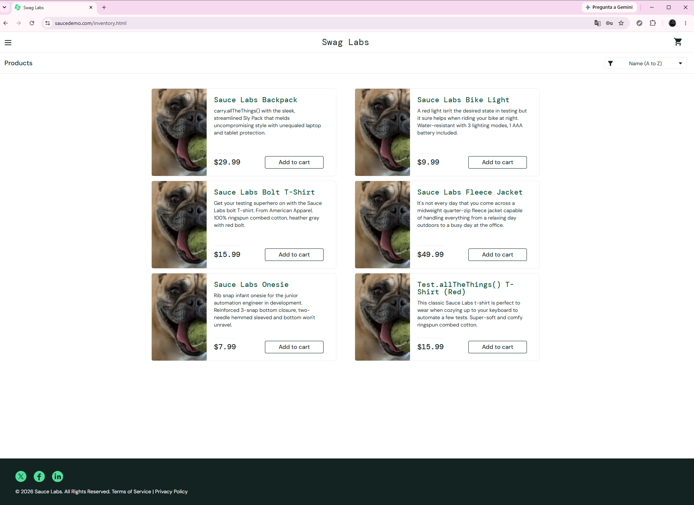

## DEF02 El ordenamiento no cambia el orden de los productos

- Caso y requerimiento: TC13 a TC16, RF06
- Usuario: problem_user
- Pasos: 1. Iniciar sesión con problem_user. 2. Seleccionar Price (high to low) en el filtro.
- Resultado esperado: los productos se ordenan por precio de mayor a menor.
- Resultado obtenido: el orden de los productos no cambia.
- Severidad / Prioridad: Media / Media
- Tipo: Funcional

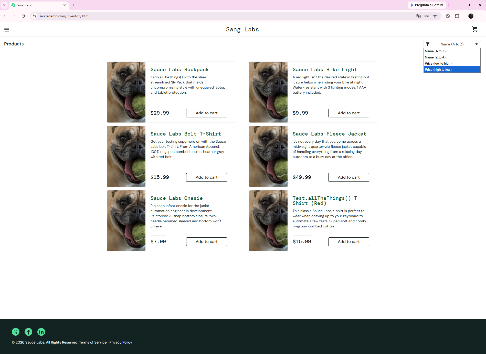

## DEF03 Solo tres botones Add to cart funcionan

- Caso y requerimiento: TC43, RF07
- Usuario: problem_user
- Pasos: 1. Iniciar sesión con problem_user. 2. Presionar Add to cart en cada uno de los seis productos.
- Resultado esperado: todos los botones cambian a Remove y el contador del carrito llega a 6.
- Resultado obtenido: solo funcionan Sauce Labs Backpack, Sauce Labs Bike Light y Sauce Labs Onesie. Los demás no cambian y el contador queda en 3.
- Severidad / Prioridad: Alta / Alta
- Tipo: Funcional

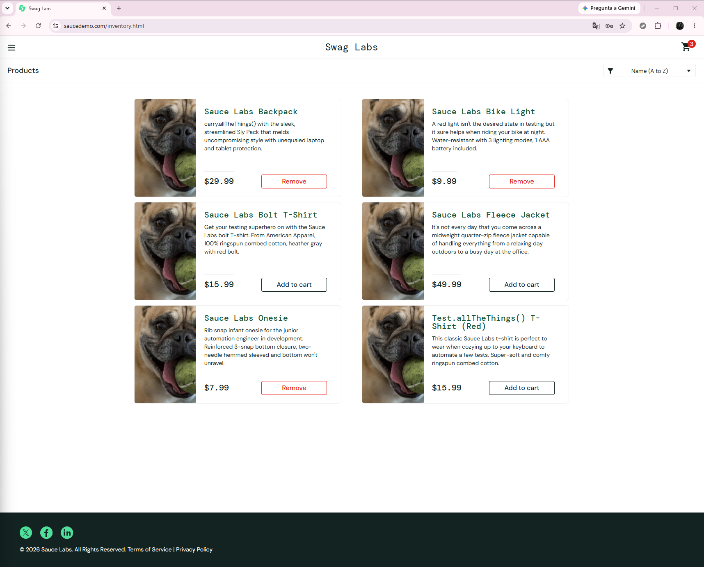

## DEF04 Ningún botón Remove funciona

- Caso y requerimiento: TC43, RF07
- Usuario: problem_user
- Pasos: 1. Iniciar sesión con problem_user. 2. Agregar un producto. 3. Presionar Remove en ese producto.
- Resultado esperado: el botón vuelve a Add to cart y el contador baja.
- Resultado obtenido: al presionar Remove en Sauce Labs Backpack, el botón sigue en Remove y el contador se mantiene en 3.
- Severidad / Prioridad: Alta / Alta
- Tipo: Funcional

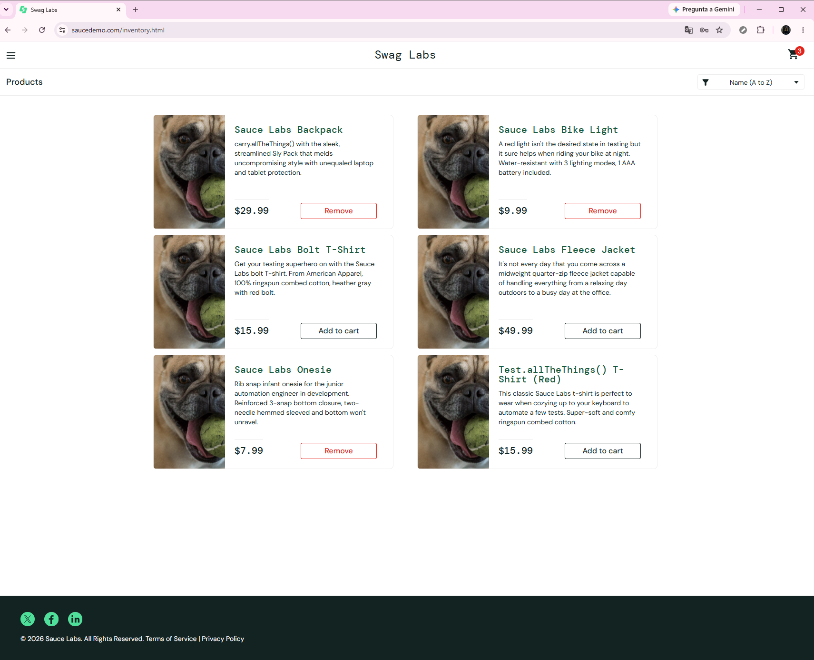

## DEF05 El clic en un producto abre otro producto

- Caso y requerimiento: TC42, RF05
- Usuario: problem_user
- Pasos: 1. Iniciar sesión con problem_user. 2. Hacer clic en el nombre de Sauce Labs Backpack.
- Resultado esperado: se abre el detalle de Sauce Labs Backpack.
- Resultado obtenido: se abre el detalle de Sauce Labs Fleece Jacket.
- Severidad / Prioridad: Media / Media
- Tipo: Funcional

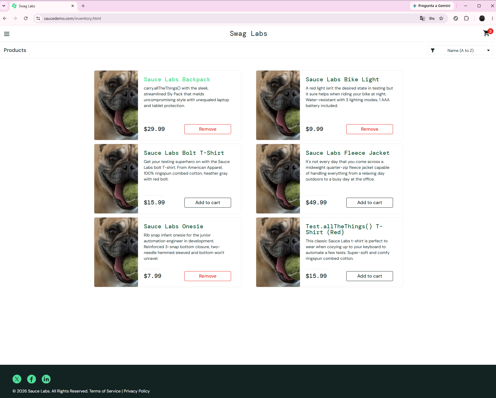
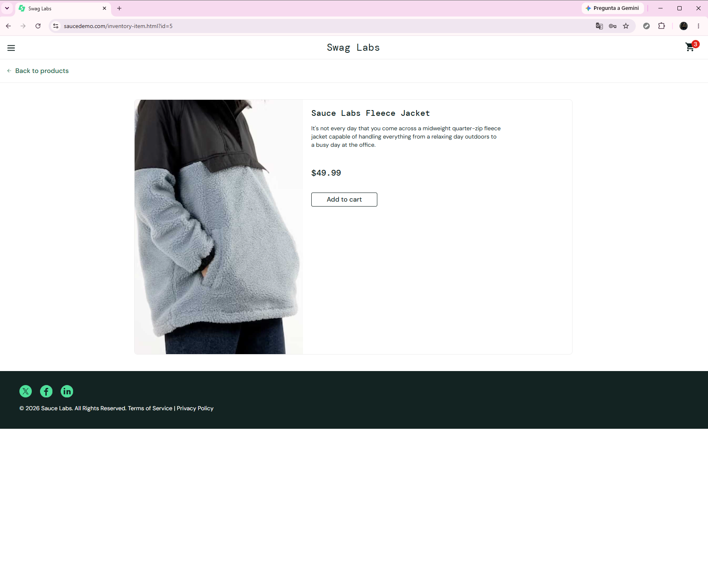

## DEF06 El apellido no se puede escribir en el checkout

- Caso y requerimiento: TC43, RF09
- Usuario: problem_user
- Pasos: 1. Iniciar sesión con problem_user. 2. Agregar un producto e ir al carrito. 3. Presionar Checkout. 4. Escribir nombre, apellido y código postal.
- Resultado esperado: cada campo guarda el texto escrito.
- Resultado obtenido: al escribir en Last Name, el texto se escribe en First Name y Last Name queda vacío.
- Severidad / Prioridad: Alta / Alta
- Tipo: Funcional

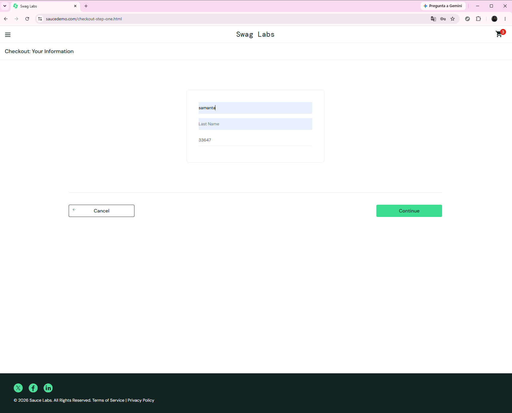

## DEF07 El ordenamiento no funciona y muestra una alerta de error

- Caso y requerimiento: TC13 a TC16, RF06
- Usuario: error_user
- Pasos: 1. Iniciar sesión con error_user. 2. Abrir la consola del navegador (F12). 3. Seleccionar Price (low to high).
- Resultado esperado: los productos se ordenan por precio de menor a mayor.
- Resultado obtenido: el orden no cambia y se muestra la alerta "Sorting is broken! This error has been reported to Backtrace."
- Severidad / Prioridad: Media / Media
- Tipo: Funcional

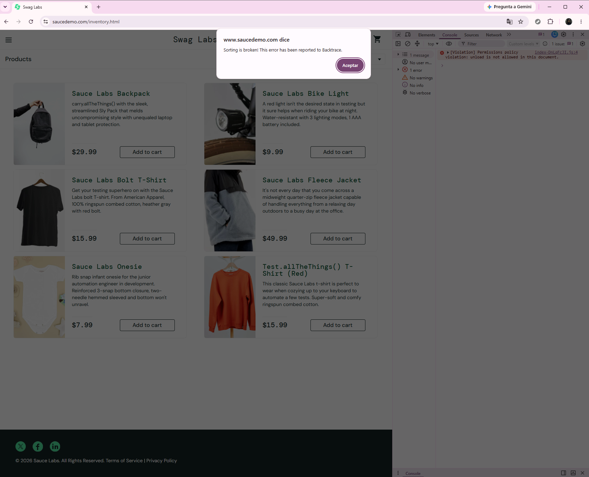

## DEF08 Add to cart genera errores

- Caso y requerimiento: TC44, RF07
- Usuario: error_user
- Pasos: 1. Iniciar sesión con error_user. 2. Abrir la consola del navegador (F12). 3. Presionar Add to cart en cada producto.
- Resultado esperado: todos los productos se agregan y el contador sube.
- Resultado obtenido: en Sauce Labs Bolt T-Shirt, Sauce Labs Fleece Jacket y Test.allTheThings() T-Shirt (Red) el botón no responde y la consola muestra "Uncaught Error: Failed to add item to the cart".
- Severidad / Prioridad: Alta / Alta
- Tipo: Funcional

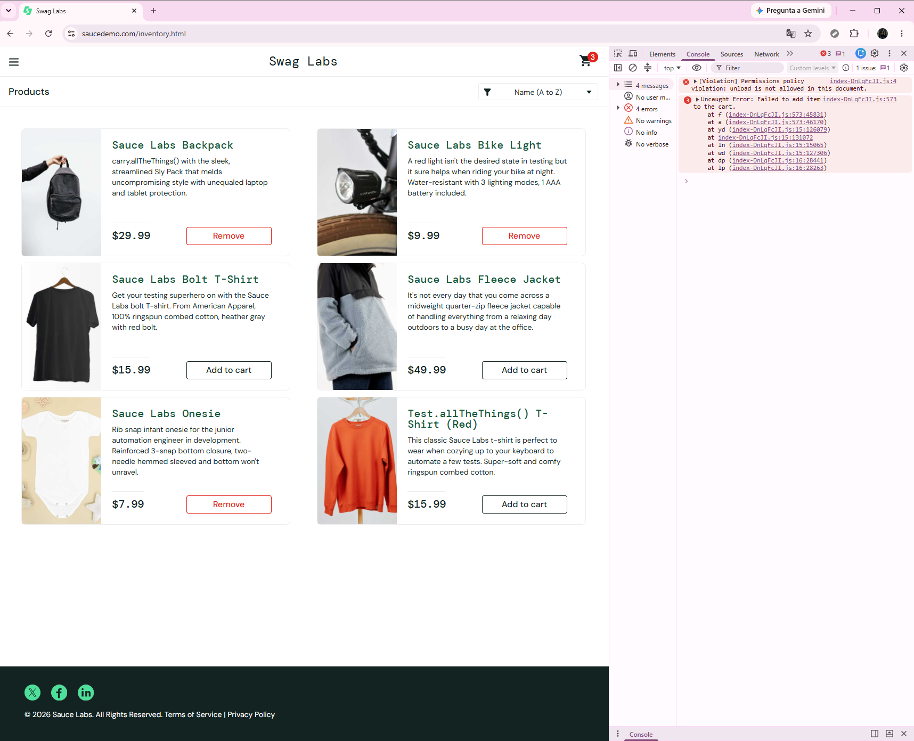

## DEF09 El checkout no permite ingresar el apellido

- Caso y requerimiento: TC44, RF09
- Usuario: error_user
- Pasos: 1. Iniciar sesión con error_user. 2. Agregar un producto e ir al checkout. 3. Escribir nombre, apellido y código postal.
- Resultado esperado: el campo de apellido acepta el texto.
- Resultado obtenido: el campo Last Name no acepta texto y queda vacío. La consola muestra "Uncaught TypeError: Cannot read properties of undefined (reading 'value')".
- Severidad / Prioridad: Alta / Alta
- Tipo: Funcional

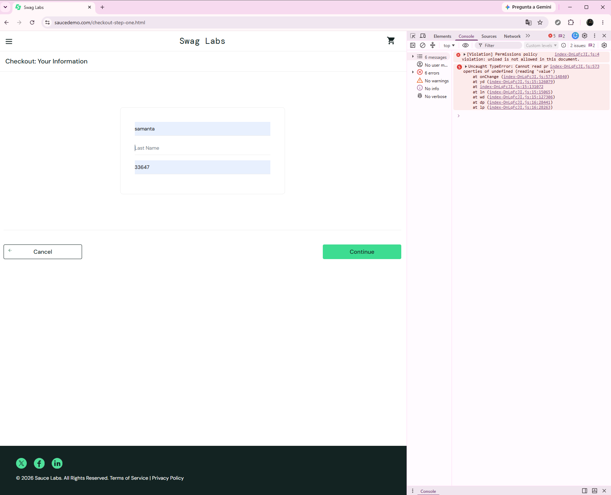

## DEF10 El botón Finish no completa la compra

- Caso y requerimiento: TC44, RF10
- Usuario: error_user
- Pasos: 1. Iniciar sesión con error_user. 2. Agregar un producto e ir al checkout. 3. Llenar el formulario y presionar Continue. 4. Presionar Finish.
- Resultado esperado: se muestra Thank you for your order!
- Resultado obtenido: la página se queda en Checkout: Overview y la consola muestra "Uncaught TypeError: ... is not a function".
- Severidad / Prioridad: Alta / Alta
- Tipo: Funcional

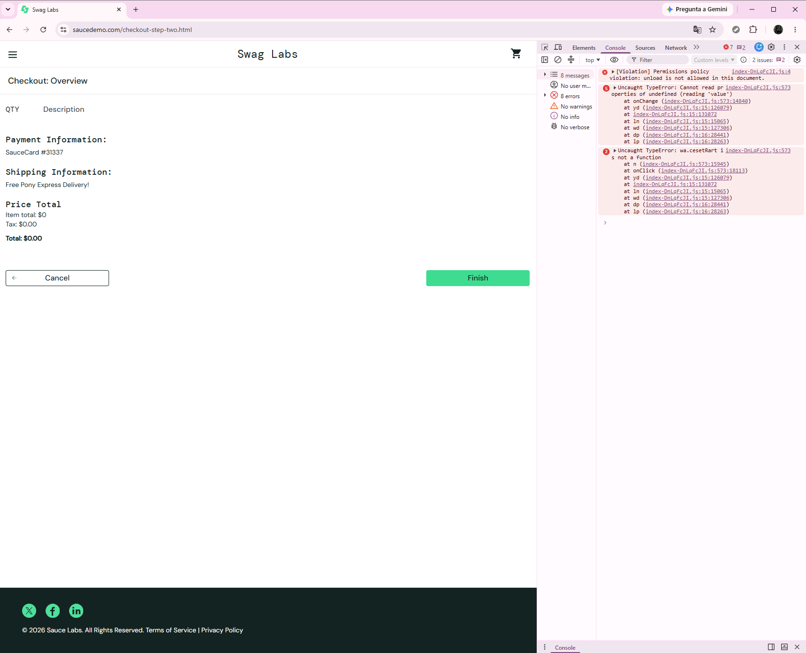
